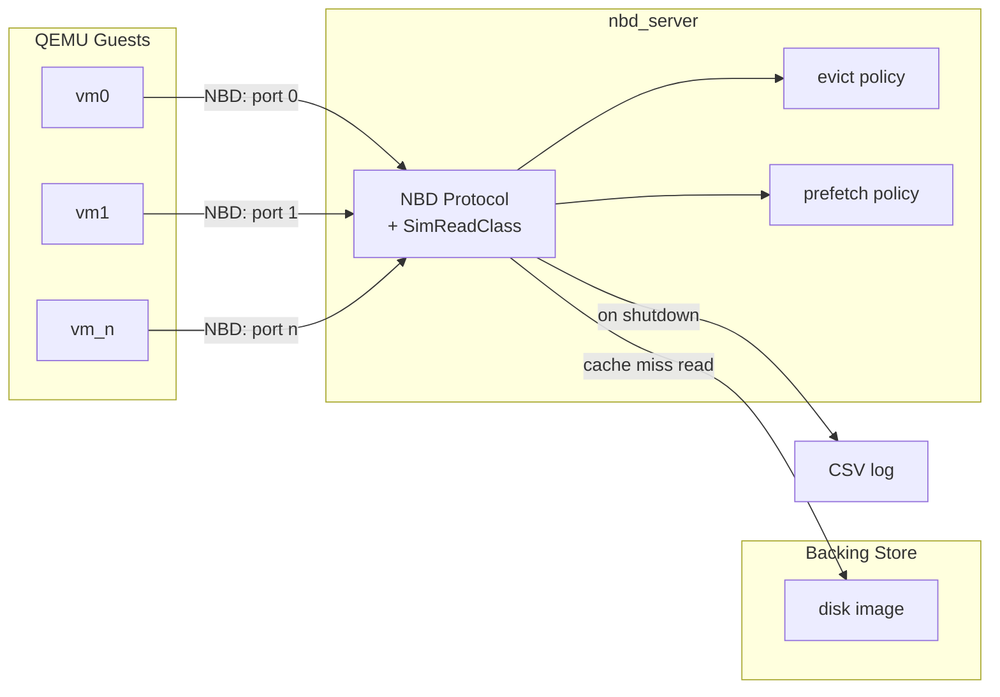

# newexp2: NBD-backed disk cache-policy simulator

This repo serves a backing file to real QEMU VMs over the NBD wire protocol,
running every read through a software-managed cache/policy simulator, so
that cache replacement and prefetch policies can be measured against actual
VM disk traffic rather than a synthetic workload generator.

The workflow is:

1. **Create disk** — provision a backing file (`make disk`).
2. **Spin up disk server** — `nbd_server` (`disk/nbd.cpp`) serves that file
   over NBD, one TCP port per client identity, running every read through
   `policy::Cache` and a configured evict/prefetch policy (`make nbd-run`).
3. **Spin up VMs** — QEMU guests attach the server's ports as ordinary
   virtio-blk disks (`make vms-up`, wraps `kvm/launch.py`).
4. **Test on VMs** — drive the guests directly (ssh/console); their disk
   I/O is transparently going through the simulator.
5. **Get measurements & log** — stop the server (Ctrl-C/SIGTERM); it
   appends one row of hit/miss/latency stats to a CSV log.



## Components

### disk/nbd.cpp (`nbd_server`)

Implements the NBD wire protocol (fixed newstyle handshake,
`NBD_OPT_EXPORT_NAME`, simple-reply transmission) so the in-kernel `nbd`
driver, `nbd-client`, or QEMU's `driver=nbd` block backend can attach to it
directly. Reads are served through `disk/sim.hpp`'s `SimReadClass`, so every
byte a guest reads is charged simulated hit/miss latency and run through
whatever evict/prefetch policy is configured — writes/trims/flushes are
accepted and discarded (nothing a guest writes is ever persisted).

The server listens on one TCP port per entry in a config file's `ports:`
list. These ports can be overriden in the command line.
**Each port is its own client identity**: a VM disk that dials a given
port is tracked separately from every other VM's disk for cache
virtual-time/prefetch purposes (`worker_id` in `SimReadClass`) — assign one
port per VM disk you want the simulator to treat as distinct. Note that all
ports on one `nbd_server` process still read from the *same* backing file;
if VMs need genuinely different disk contents, run separate `nbd_server`
processes (or configs) with different `file:` paths.

Takes 1+ arguments: a config file path (a deliberately small YAML
subset — flat `key: value` lines, `#` comments, one inline list for
`ports:`). See [`disk/nbd.example.yaml`](disk/nbd.example.yaml) for the full
schema (backing file, ports, cache capacity, hit/miss latency, warmup,
evict/prefetch policy, log path). And possibly a list of ports.

### disk/sim.hpp (`SimReadClass`)

Drives `policy::Cache`/`policy::CachePolicy` from real NBD read requests
(offset/length in bytes, converted to `SECTOR_SIZE`-sized pages) instead of
a synthetic request generator. For each request it: checks cache presence
per page, runs the configured prefetch policy's `on_prefetch_request` (then
admits whatever it suggests), runs the evict policy's `on_access`, and
charges simulated latency accordingly — then serves the actual bytes via
`pread` on the backing file (thread-safe/offset-explicit, since the backing
`FILE*` is shared across every client thread).

### disk/fwd.cpp, disk/fwd_sim.cpp (remote disk: direct vs local cache)

A *physically remote* disk, to compare "guest NBD attached straight to the
remote disk" against "guest NBD attached to a local disk cache that reads
ahead":

- `RemoteDiskServer` (`bin/fwd_sim serve`) is the far side: a separate process
  serving a file over TCP. Every request pays the link RTT, the disk's service
  time, and a share of the link bandwidth, all enforced with real sleeps (no
  simulated clock). Demand traffic is prioritized over prefetch traffic on the
  link (`--prio 0` turns that off).
- `RemoteClient` is the near side's connection pool (separate demand and
  prefetch pools, so speculation can't starve a blocked guest read).
- `DirectReadClass` forwards every read. `FwdReadClass` is the local disk
  cache: pages live in an unlinked local file, `policy::Cache` + the usual
  evict/prefetch policies decide residency, and prefetches are fetched on
  background connections *while the guest thinks*. A guest read that needs a
  page whose prefetch is still queued takes it over rather than waiting.
- Both are `nbd::BlockReadClass`es, so they plug into `nbd_server` with
  `source: remote` (see `disk/nbd.example.yaml`) and real VMs can sit behind
  them. Writes still go to the local copy-on-write overlay; the remote disk is
  read-only.

`make fwd-experiment` builds `bin/fwd_sim` and runs `disk/fwd_experiment.py`:
network scenarios (`lan`/`wan`/`far`) x workloads (`seq`, `seqjump`, `stride`,
`random`, `zipf`, and `trace` = replay of `logs/nbd_access.csv`) x modes
(`direct`, `cache`, `readahead`, `stream`). The remote disk is a generated
pattern image, and every byte the guest side reads is verified, so a cache bug
shows up as a mismatch instead of a flattering latency number. Output:
`logs/fwd/results.csv` (one row per run) and `logs/fwd/summary.md`. "Total
latency" is the sum of every read's wait; wall time also includes the guest's
think time (`--think-us`), which is what lets prefetching overlap the guest.
Pass options with `FWD_ARGS`, e.g.
`make fwd-experiment FWD_ARGS="--quick --scenarios wan --think-us 0,200,2000"`.
`python3 disk/test_fwd.py` is the no-QEMU end-to-end check of `source: remote`
(including pipelined reads with `read_concurrency`).

**With a VM in the loop.** The replay above issues reads one at a time from a host process, which overstates
what a cache can add: a real guest has its own page cache and readahead and keeps several reads in flight.
`tools/capture/vm_remote_study.py` boots a QEMU guest running the real FAISS search over the remote disk
(`run_capture.py --remote-rtt-us ...`), records the guest's own query latencies, and covers local-disk
references, a serial-vs-overlapped `nbd_server` comparison, and a guest-readahead ablation
(`--ablation`, which sets the guest's `read_ahead_kb`). Each run hashes the search results, so the VM path's
data correctness is checked too. `nbd_server`'s `read_concurrency` (default 8, any source) serves reads in parallel
per connection; QEMU pipelines requests, and a server that handles one at a time (`read_concurrency: 1`,
the behaviour before this option existed) penalizes the direct baseline. `disk/fwd_calibrate.py` measures the emulated link against its arithmetic model, and
`disk/fwd_report.py` rebuilds the write-up page from the CSVs. `vm_remote_study.py --depth-sweep` varies the host's readahead
depth (`readahead_pages`) and `--diag` re-runs one deep depth with a larger cache, an unlimited link, and lock-contention
counters (`FwdReadClass` prints `lock_wait_ms`/`bulk_hold_ms` at shutdown). `FwdReadClass` keeps its pages in a memory-mapped
file and still copies each fetched page under one lock; that lock is the cost deep readahead pays on a fast link. Run `nbd_server` configs with explicit
`access_log`/`prefetch_log` paths: leaving them unset still truncates `logs/nbd_access.csv`.

### policies/

Evict policies (`evict_policy:` in the config): `none`, `fifo`, `lifo`,
`lru`, `mru`, and `lru_seg[:unused=PCT]` (LRU with a protected FIFO segment for
prefetched-but-unused pages, so a burst of prefetches doesn't push out pages
that were about to be read and just-consumed pages don't push out unused
prefetches; recommended with the learned prefetchers).

Policy values are **specs**: `name`, or `name:key=value,key=value`
(`readahead:pages=16`, `learned:theta=30`, `lru_seg:unused=75`), and `a+b`
runs two prefetch policies and prefetches the union. See
[`policies/policy_factory.h`](policies/policy_factory.h) for every key.

Prefetch policies (`prefetch_policy:`): `none`, `readahead` (fetches the
next `MAX_PREFETCH_PAGES` pages), and three association-mining policies
sharing one engine ([`policies/assoc_miner.h`](policies/assoc_miner.h)) —
`cminer` (one shared association table across all clients), `quickmine`
(one table per client context, so unrelated clients' accesses don't pollute
each other's associations), and `mithril` (like `cminer`, but skips pages
that have already gone "hot," reserving mining budget for
sporadically-recurring pages).

**`learned[:theta=T]`** is the prefetcher tuned for VM workloads (FAISS on-disk
IVF, the Thesios storage trace). A guest's page cache and readahead have already
turned the application's accesses into windows (128 KiB mmap read-around, 256 KiB
/ 1 MiB reads, ...), so the host sees those, in two shapes, and `learned` runs a
predictor for each, both learning online from the stream itself (no offline
training, nothing workload-specific):

- `nextreq` ([`policy_nextreq.cpp`](policies/policy_nextreq.cpp)): interleaved
  sequential streams that advance a burst at a time. Per stream it learns the
  length of the next request (from byte-exact history: 1 MiB, 256 KiB, 1 MiB, ...),
  how far past the previous end it starts, and how often a stream in that state is
  continued at all, and prefetches the pages of the next few predicted requests
  when that is likely enough. A read only counts as a full hit if the *whole*
  request is cached, so the unit of prediction is the request, not the page.
- `neighborhood` ([`policy_neighborhood.cpp`](policies/policy_neighborhood.cpp)):
  windows that land around a point and fill in around it in no fixed order (mmap
  read-around). It learns P(page d pages beside a request is requested within the
  next 32 requests) per request shape, distance and "is this page enclosed by two
  recent requests", and prefetches the pages above `theta`.

`T` (percent, default 40) is the one knob: lower = more hits and more backend
traffic. On random traffic (YCSB, GUPS) both learn that nothing near a request
follows it and stop prefetching (about 1.0x traffic, where `readahead` costs
16x or more). Design notes, measurements and the dead ends are in
[`DECISIONS.md`](DECISIONS.md); the replay harness used to develop it is
[`tools/pf/`](tools/pf/README.md).

`oracle` reads an `nbd_access.csv`-shaped trace from `oracle_file` (default
`./logs/oracle.csv`) and prefetches the range following the closest request
in each worker's bounded trace lookahead window. This provides an approximate
headroom bound even when boot or workload behavior diverges between runs. The
trace header must be
`worker_id,offset,length,hits,total`; `hits` and `total` are accepted for
compatibility but are not used.

`model-prefetcher` launches `python3 -m <prefetcher_path>` before opening the NBD
listeners. It requires `prefetcher_path`, `prefetcher_type`,
`prefetcher_min_len`, and `prefetcher_training`; the latter three are passed
as the offline model's `--type`, `--min-len`, and `--training` arguments.
The model is queried over its JSON-lines `get`/`put` API with one history per
NBD worker.

`policy_lru_cxt_aware.cpp` is a context-aware LRU variant, partitioned by
client identity while keeping total cache capacity fixed.

### kvm/launch.py

Spins up/tears down one or more QEMU guests from a YAML config (see
[`kvm/vms.example.yaml`](kvm/vms.example.yaml)) — every disk a VM lists gets
its own `driver=nbd` QEMU block backend pointed at an `nbd_server`
host:port, so inside the guest each disk enumerates as a completely
ordinary local block device (`/dev/vda`, `/dev/vdb`, ...); the NBD
transport is invisible to it. Requires PyYAML and, wherever it actually
runs, `qemu-system-{arch}` with KVM available.

### kvm/guest/build_image.sh (`make guest-image`)

Builds a real bootable guest instead of a blank disk: a Debian rootfs
(debootstrap) with Python, numpy, and faiss baked in, plus a systemd unit
(`workload.service`) that runs a workload script once on every boot, and
extracts the kernel/initrd `kvm/vms.yaml` boots via `-kernel`/`-initrd`.
Override `WORKLOAD_SCRIPT` to bake in a different script (default
[`kvm/guest/workloads/ycsb_bench.py`](kvm/guest/workloads/ycsb_bench.py) —
see below; [`kvm/guest/workloads/faiss_bench.py`](kvm/guest/workloads/faiss_bench.py),
a CPU-heavy FAISS HNSW index-build-and-search benchmark, and
[`kvm/guest/workloads/gups_bench.py`](kvm/guest/workloads/gups_bench.py), a
disk-based GUPS/RandomAccess benchmark — see [GUPS workload](#gups-workload)
below — are still available by setting `WORKLOAD_SCRIPT` explicitly); its
stdout lands on the guest's serial console, logged to
`<log_dir>/<name>.serial.log`.

This writes straight to `disk/data/nbd_disk.img` via `debootstrap`/`chroot`
on the host — a completely different path from `nbd_server`, which discards
every write a *running* guest makes to that same file (see `disk/sim.hpp`
above). That's why `kvm/vms.yaml`'s default `append` boots with
`systemd.volatile=state`: root (including `/opt`, where baked-in data like
the YCSB dataset lives) is mounted read-only from the real disk, with only
`/var` as a tmpfs overlay, so the guest never depends on a write actually
landing on disk mid-run while reads of baked-in data still genuinely reach
`nbd_server`. (Not `systemd.volatile=yes` — that tmpfs's everything outside
`/usr`, wiping `/opt/workload` on every boot.) Needs root and
`debootstrap`, and is Debian/Ubuntu-only.

#### YCSB workload (default)

By default (`GUEST_YCSB=1`) the image also gets a real
[YCSB](https://github.com/brianfrankcooper/YCSB) benchmark: a JRE, the YCSB
release tarball, and the generic JDBC binding paired with a SQLite driver
(YCSB has no bundled SQLite binding). At build time — not boot time — a
`GUEST_YCSB_RECORDS`-record dataset (default 10,000,000, sized to land well
above the guest's 4G RAM in `kvm/vms.yaml` so it can't all be absorbed by
the guest's own page cache) is loaded into a SQLite table under
`/opt/workload/ycsb.db`. Only `bin/ycsb run` (the transaction phase) runs
at boot, driven by `kvm/guest/workloads/ycsb_bench.py`; only a read-only
workload (default `GUEST_YCSB_WORKLOAD=workloadc`, 100% reads) is viable
there, since `kvm/vms.yaml` mounts root `ro`. Tunable via `GUEST_YCSB_*`
Makefile vars — see the Makefile's `guest-image` section for the full list
(record/field count and size, operation count, key distribution, thread
count, YCSB/sqlite-jdbc versions). Set `GUEST_YCSB=0` to skip all of this
and use a smaller/faster `GUEST_ROOTFS_SIZE` with `faiss_bench.py` instead.

#### GUPS workload

Set `GUEST_GUPS=1` to also bake in a disk-based analogue of the HPC
Challenge ["GUPS" (RandomAccess)](https://hpcchallenge.org/) benchmark: at
build time a `GUEST_GUPS_TABLE_MB`-megabyte table (default 6144, sized to
land well above the guest's 4G RAM, same reasoning as `GUEST_YCSB_RECORDS`)
is written — for real, not left sparse, since a sparse hole would let the
guest's own ext4 resolve reads as all-zero in-kernel without ever reaching
`nbd_server` — to `/opt/workload/gups_table.bin`. At boot,
`kvm/guest/workloads/gups_bench.py` issues `GUEST_GUPS_UPDATES` (default
2,000,000) pseudo-random `GUEST_GUPS_BLOCK_SIZE`-byte (default 4096) reads
against that table and reports the achieved GUPS rate; only the read half
of GUPS's usual read-XOR-write update runs, for the same read-only-root
reason as YCSB above. `GUEST_GUPS` is independent of `GUEST_YCSB` — both
datasets can be baked into the same image at once, with `WORKLOAD_SCRIPT`
picking which one actually runs at boot:

```bash
make guest-image WORKLOAD_SCRIPT=kvm/guest/workloads/gups_bench.py \
  GUEST_YCSB=0 GUEST_GUPS=1 GUEST_ROOTFS_SIZE=8G
```

#### Thesios workload

Set `GUEST_THESIOS=1` and select
[`kvm/guest/workloads/thesios_bench.py`](kvm/guest/workloads/thesios_bench.py)
to download and bake one public Thesios CSV shard, then replay its `READ`
requests against the guest's raw root block device. By default, four shards
(`data-00000` through `data-00003`) are downloaded. Override
`GUEST_THESIOS_TRACE_URLS` with a comma-separated list of shard URLs to select
others. The host-side
[`prepare_thesios.py`](kvm/guest/prepare_thesios.py) deletes each full CSV
after extracting only `offset,length` pairs into the image. Set
`GUEST_THESIOS_MAX_REQUESTS` to a positive value to bound the replay; `0`
replays the complete condensed file. Thesios `file_offset` values
are file-relative, so this replay preserves the recorded offsets as provided
and requires an image/device large enough for them. The default cluster is
16 TB, so use a sparse 16-TB root image when replaying it:

Set `GUEST_THESIOS_DIRECT_IO=1` to open the workload device with `O_DIRECT`
and bypass the guest page cache. The default `0` preserves ordinary cached
reads.

```bash
make guest-image \
   WORKLOAD_SCRIPT=kvm/guest/workloads/thesios_bench.py \
   GUEST_YCSB=0 GUEST_THESIOS=1 GUEST_ROOTFS_SIZE=16T
```

Writes and malformed rows are skipped. The selected shard is downloaded at
image-build time, so the guest does not need network access at boot. The
dataset is published under CC-BY by the
[Thesios project](https://github.com/google-research-datasets/thesios).

## Build and Run

### Control room

Start the local control panel with:

```bash
make ui
```

Open `http://127.0.0.1:8765`. It provides allowlisted controls for compiling,
building the guest image, launching a selected existing scenario, normal or
forced teardown, recent result rows, live server/action logs, and read-only
inspection of the ext4 backing image through `debugfs`. The panel binds only
to localhost and does not execute arbitrary commands.

Everything below is Linux-only (`disk/nbd.cpp` needs `<endian.h>`;
`kvm/launch.py` needs `qemu-system` and `/dev/kvm`) — run it on the Linux
host/VM that will actually host the disk server and the guests.

1. **Create the disk** — a sparse, zero-filled backing file, left alone
   after creation (delete it yourself to resize/reset; `dd` real content
   into it, or write files to it from inside a guest, once VMs can attach):

```bash
make disk DISK_SIZE=4G
```

   To instead boot a real guest that runs a workload script on boot, build
   a Debian image with Python/numpy/faiss and a real YCSB benchmark + a
   pre-loaded SQLite dataset baked in (needs root and `debootstrap`,
   Debian/Ubuntu-only, and takes a while — it downloads a JRE, YCSB, and
   loads a multi-GB dataset) instead of the plain zero-filled file:

```bash
make guest-image
```

   (or `make guest-image WORKLOAD_SCRIPT=kvm/guest/workloads/faiss_bench.py
   GUEST_YCSB=0 GUEST_ROOTFS_SIZE=3G` for the smaller/faster FAISS-only
   workload instead — see [YCSB workload](#ycsb-workload-default) above for
   the full set of `GUEST_YCSB_*` tunables; or
   `make guest-image WORKLOAD_SCRIPT=kvm/guest/workloads/gups_bench.py
   GUEST_YCSB=0 GUEST_GUPS=1 GUEST_ROOTFS_SIZE=8G` for the GUPS/RandomAccess
   workload — see [GUPS workload](#gups-workload) above for the
   `GUEST_GUPS_*` tunables)

2. **Build and start the disk server** — builds `nbd_server`, generates
   `disk/nbd.yaml` from the `NBD_*` variables, and runs in the foreground:

```bash
make nbd-run NBD_PORTS="10809 10810" NBD_EVICT_POLICY=lru NBD_PREFETCH_POLICY=cminer
```

3. **Spin up VMs** — `kvm/vms.yaml` is the default (`VMS_CONFIG`), already
   matching disk/nbd.yaml's defaults; edit it (or point `VMS_CONFIG` at your
   own copy of `kvm/vms.example.yaml`) if each disk's `nbd.host`/`nbd.port`
   needs to differ from the machine and port(s) from step 2, then:

```bash
make vms-up
```

4. **Test on VMs** — ssh (if `network.type: user` with `hostfwd`) or drive a
   guest's serial console via its monitor socket (`<run_dir>/<name>.monitor`)
   and its console output at `<log_dir>/<name>.serial.log`; either way, its
   disk I/O is going through `nbd_server`'s cache simulation. `nbd_server`'s
   stderr logs a line per accepted connection, so that's the first signal a
   guest actually reached it.

   If the guest is a `make guest-image` build, `workload.service` powers it
   off once the baked-in workload script exits, so `make vms-wait` (wraps
   `kvm/launch.py --wait`) blocks until every VM's QEMU process has exited
   and is the signal that it's safe to move on to step 5.

5. **Stop and collect measurements** — Ctrl-C (or `SIGTERM`) the server from
   step 2; it appends one row to the CSV log (see below), then:

```bash
make vms-down
```

Remove build artifacts (binaries only — the disk image and logs are left
alone) with `make clean`; `make disk-clean` removes the disk image
specifically.

All `NBD_*`/`DISK_*`/`VMS_CONFIG` Makefile variables can be overridden at
invocation; see the Makefile for the full list and their defaults.

## Logging Schema

On a clean shutdown (`SIGINT`/`SIGTERM`), `nbd_server` prints one
`STATS key=value ...` summary line to stdout and appends one CSV row to the
config's `log:` path (default `./logs/nbd_results.csv`), writing a header
first if the file is new or empty. If an existing log has an older column
layout it is renamed to `<log>.old-<unix time>` and a fresh file is started. Columns:

- `timestamp`, `machine`, `commit_hash` — when/where/which commit ran
- `file`, `ports`, `capacity`, `hit_latency_ns`, `miss_latency_ns`,
  `warmup`, `evict_policy`, `prefetch_policy` — the run's config
- `request_count`, `miss_requests`, `hits`, `misses`, `hit_ratio`,
  `evictions`, `bytes_read`, `bytes_written` — cache outcomes, post-warmup
  only. `request_count` counts NBD read requests; `miss_requests` is the
  subset with at least one missing sector; `hits`/`misses`/`hit_ratio` count
  sectors; `evictions` includes both policy-requested and capacity evictions
- Latency, in ns, summed over post-warmup requests. The three parts add up
  exactly: `total_latency_ns = worker_latency_ns + policy_latency_ns +
  miss_delay_ns`, and `avg_latency_ns = total_latency_ns / request_count`
  - `worker_latency_ns` — the guest's own think time between a response
    being fully sent and its next request (no disk-side time, no miss delay)
  - `policy_latency_ns` — real compute time of every evict/prefetch policy
    hook (not `pread` or cache bookkeeping)
  - `miss_delay_ns` — the modeled miss penalty: `miss_requests *
    miss_latency_ns` (one charge per request with a miss, not per sector)
- Clocks, in seconds:
  - `runtime_seconds` — wall-clock time the server was up (includes boot and warmup)
  - `measured_runtime_seconds` — wall clock since the last warmup request
  - `simulated_time_seconds` — virtual clock since the last warmup request
    (think time + policy compute + miss delay)
- `latency_mode` — `simulated` (miss delay is only accounted) or `physical`
  (also slept for real), as configured for the run
- `workload`, `workload_runtime_seconds` — the guest workload's name and the
  wall time of just the workload process, read at shutdown from the
  `<vm_log_dir>/<vm>.share/workload.info` file the guest's `run.sh` writes
  into the 9p directory `kvm/launch.py` shares with each VM (only files
  modified since the server started).
  `runtime_seconds` minus this approximates kernel/boot-incurred time. Multiple
  VMs are `;`-joined; empty if unavailable (e.g. a guest not built by
  `make guest-image`, or the VM still running).

Independently, every request is also logged as it happens (not just on
shutdown) to the config's `access_log:` path (default
`./logs/nbd_access.csv`), overwritten fresh on each server start. Columns:
`worker_id`, `offset`, `length` (bytes), `hits`, `total` (pages of the
request that were a cache hit vs. touched overall). No timestamp column —
row order is the access order. See `disk/sim.hpp`'s `SimReadClass` and
`kvm/verify_capture.py`/`disk/test_protocol.py`, which cross-check it
against known request patterns.

`disk/heatmap.py` renders this log as a page-access-density-over-time
heatmap (`make heatmap`, or `python3 disk/heatmap.py [access_log]`);
requires matplotlib (`pip install matplotlib`).

Likewise `prefetch_log:` (default `./logs/nbd_prefetch.csv`) gets one row per
range the prefetch policy fetched: `worker_id`, `offset`, `length` (bytes),
`hits`/`total` (pages already cached vs. in the range — i.e. wasted
prefetch), and `req` (index of the read that triggered it). Same shape as the
access log, so `python3 disk/heatmap.py logs/nbd_prefetch.csv --out
prefetch_heatmap.png` renders it for side-by-side comparison.

## Commenting and Code Style Guidance

To keep implementation readable while performance-tuning:

- Comment synchronization decisions (lock ordering, atomic ownership, wait conditions).
- Comment policy edge cases (eviction tie-breaks, per-context partition behavior).
- Comment wire format assumptions for request/response messages (NBD protocol, config parsing).
- Avoid redundant comments for obvious operations.

Example style:

```cpp
// Preserve a total order on locks to avoid inversion between request and eviction paths.
std::scoped_lock lk(global_mu, shard_mu);

// Treat warmup requests as non-observable for user-facing latency metrics.
if (request_index < warmup_period) {
	return;
}
```
