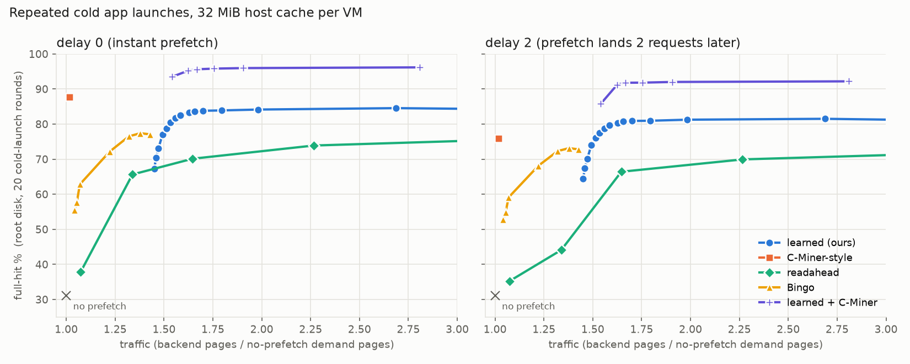

# Is there a trustworthy workload where `learned` loses?

**Setting (unchanged):** the host prefetches for a guest. Every workload below ran **inside a QEMU guest**, with the
guest's page cache, readahead, I/O scheduler and process interleaving in the loop. The block stream it sent over NBD
was captured and replayed through every policy with `bin/psim`. Nothing was replayed directly from an application
trace on the host.

**Answer: yes, one clean case, plus a few smaller or conditional ones.**

1. **Repeated cold application launches** (container and serverless cold starts) from the guest's real Debian root
   disk. This holds whenever the VM's share of the host cache is smaller than the launch working set. A
   C-Miner-style block-correlation prefetcher beats `learned` at every traffic budget with instant prefetch: 87.7% vs
   84.2% full hit, using 1.02× traffic instead of 1.98×. With prefetches landing 2 requests late it wins below about
   1.5× traffic, and `learned` wins above that. It wins on both full-hit and page-hit.
2. **YCSB-C on RocksDB in a 1.5 GiB guest.** This one depends on the metric: C-Miner-style is ahead on full hits
   (25.1% vs 22.4%) but behind on page hits (29.6% vs 36.1%).
3. **Already known, small:** Thesios with instant prefetch, where readahead leads by about 1.5 points at 2×. And
   every workload below about 1.3× traffic, the `learned` traffic floor described in `PUBLISHED_PREFETCHERS.md`.

Running `learned` and the C-Miner-style prefetcher together (`learned+cminer`) beats both in cases 1 and 2. It costs
0.2–1.2 points on the rest of the suite at 2× traffic, and more at tight budgets.



## Workloads tested

All of these are standard tools or benchmarks, run inside the guest and captured with `tools/capture/new_streams.sh`
(new) or `tools/pf/gen_streams.sh` (the earlier suite). Policy `none` was used during capture.

| stream | workload (inside the guest) | data | guest RAM |
|---|---|---|---|
| `lx_grep`, `lx_grep_ra512` | 3 passes of `grep -r` over the Linux 6.6 source tree (guest readahead 128 / 512 KiB) | kernel.org tarball, checksum verified; ext4 built with `mke2fs -d` | 512 MiB |
| `lx_tar` | 2 × `tar cf - linux-6.6 \| cksum` (backup) | same | 512 MiB |
| `lx_par` | 2 × `find \| xargs -P 8 md5sum` (8 interleaved processes) | same | 512 MiB |
| `lx_mix` | `grep -r` and `tar` running concurrently, 2 rounds | same | 512 MiB |
| `rk_m2g_{load,c,e}`, `rk_m1g5_{load,c,e}` | YCSB 0.17 on RocksDB (the image's `rocksdbjni` 5.11): load 6M × 1 KiB records with 4 threads, then workload C (200k zipfian reads), then workload E (20k scans); each phase cut out at guest markers | about 6 GiB LSM | 2 GiB / 1.5 GiB |
| `y_a`, `y_b` | YCSB A and B (100k operations) on SQLite via JDBC | existing 10M-record `ycsb.db` | 1 GiB |
| `al_fixed_root`, `al_shuf_root` | 20 rounds of cold launches (guest page cache dropped before each) of `python3 -c "import numpy, faiss"`, a Python stdlib import set, a YCSB Java client, `perl -MPOSIX`, `sqlite3`, `apt-cache stats`; fixed order vs random order each round. **The root-disk stream** | the guest's own debootstrapped Debian image | 1 GiB |
| earlier suite | FAISS IVF × 7, Thesios × 4, YCSB-C on SQLite | `tools/pf/README.md` | |

Policies, each swept over its own aggressiveness setting:

* **`learned`:** theta from 1 to 99. The wider range matters: with only 15–70, `learned` appeared to lose on the
  Linux tree, but that was an artifact of the sweep.
* **Readahead, BOP, SPP, SPP+PPF, Bingo, Pythia, Leap:** the ports in `policies/policy_lit.cpp`.
* **The repo's storage-cache prefetchers:** `cminer`, `quickmine`, `mithril` and `readahead_cxt_aware`.

Metrics are as in `PUBLISHED_PREFETCHERS.md`: full-hit % at matched traffic (backend pages over no-prefetch demand
pages), with `lru_seg` eviction, at delay 0 and delay 2. The default host cache is 256 MiB; the app-launch stream is
also run at 16–128 MiB (see the next section).

## 1. Repeated cold application launches: a C-Miner-style prefetcher wins

**What the stream looks like.** All 20 rounds read the same 156 MiB of root-disk data, about 2,100 requests and
138 MiB per round. About 9% of requests jump more than 16 MiB away from all of the previous 64 requests. That is
outside anything `learned` can predict: its neighborhood reaches ±256 pages (16 MiB) and its streams continue only from
a recent request's end. But 94% of those long jumps repeat a jump seen in an earlier round. This is the pattern a
correlation miner is built for: after page X comes page Y. Shuffling the app order each round barely changes this,
because the repetition is within each app's own launch sequence.

**About the "C-Miner" here:** it is the repo's simplified version in `policies/assoc_miner.h`, not the full C-Miner
algorithm. For every page it counts which pages follow within an 8-page window, then prefetches the top 4 followers
with support ≥ 2. With one VM, `cminer` and `quickmine` are the same code (QuickMine only splits by context).
`mithril` scores slightly lower here because it skips pages it considers "hot."

**Full hit (%) at a traffic budget. L = learned, C = C-Miner-style, U = learned + C-Miner. `al_fixed` / `al_shuf`:**

| host cache per VM | delay | @1.25× L | C | U | @2× L | C | U |
|---|---|---|---|---|---|---|---|
| 16 MiB | 0 | 44.8 / 45.2 | **86.5 / 86.5** | 50.9 / 50.8 | 80.3 / 80.4 | 86.5 / 86.5 | **94.6 / 94.2** |
| 16 MiB | 2 | 43.4 / 43.8 | **73.7 / 73.8** | 48.0 / 47.9 | 76.9 / 76.8 | 73.7 / 73.8 | **90.1 / 89.6** |
| 32 MiB | 0 | 51.2 / 51.1 | **87.7 / 88.1** | 59.9 / 59.2 | 84.2 / 84.2 | 87.7 / 88.1 | **96.0 / 95.7** |
| 32 MiB | 2 | 49.6 / 49.7 | **75.9 / 76.6** | 56.4 / 56.0 | 81.3 / 81.2 | 75.9 / 76.6 | **92.0 / 91.8** |
| 64 MiB | 0 | 62.5 / 61.2 | **89.4 / 89.7** | 65.8 / 68.6 | 86.1 / 86.2 | 89.4 / 89.7 | **96.9 / 96.7** |
| 64 MiB | 2 | 60.5 / 59.4 | **78.7 / 79.8** | 62.5 / 65.2 | 83.5 / 83.4 | 78.7 / 79.8 | **93.3 / 93.0** |
| 128 MiB | 0 | 87.1 / 71.5 | **90.3 / 92.7** | **96.6** / 76.5 | 88.1 / 88.3 | 90.3 / 92.7 | **97.3 / 97.2** |
| 128 MiB | 2 | 85.1 / 70.7 | 80.5 / **86.2** | **93.5** / 74.5 | 85.8 / 85.8 | 80.5 / 86.2 | **94.1 / 94.2** |
| 256 MiB (default) | 0 / 2 | ≈98 | ≈97 | ≈98 | ≈99 | ≈97 | ≈99 |

C-Miner-style runs at only about 1.02× traffic and 99.7% of its prefetches are used, so its value at every budget is
the same single point. Page-hit tells the same story: at 32 MiB and delay 0, C-Miner-style gets 89.4% at 1.02× and
`learned` gets 88.0% at 1.98×. With prefetches arriving 2 requests late, C-Miner-style loses about 12 points, because
it fetches only the next 4 associated pages, often too late. `learned`'s deeper neighborhood prefetches hold up
better, so at ≥2× traffic `learned` wins.

**The condition for this case:** the VM's share of the host cache must be smaller than the launch working set
(156 MiB here). At the default 256 MiB per VM the whole working set stays cached between launches: no prefetch gives
96.6% and every policy 98–99%. A real host cache is shared by many VMs, so 16–128 MiB per guest is realistic, but it
is an assumption about the deployment, not something the workload produces.

## 2. YCSB-C on RocksDB: depends on the metric

| stream | delay 0 | full hit (traffic) | page hit |
|---|---|---|---|
| `rk_m1g5_c` (1.5 GiB guest) | `learned`, best setting | 21.5 (1.14×); flat to 22.4 at higher budgets | **36.1** |
| | C-Miner-style | **25.1** (1.58×) | 29.6 |
| | learned + C-Miner (theta=25) | **36.5** (1.85×) | **48.5** |
| `rk_m2g_c` (2 GiB guest) | `learned` | **24.6** (1.17×) | **40.4** |
| | C-Miner-style | 17.6 (1.45×) | 23.2 |
| | learned + C-Miner (theta=25) | **31.8** (1.84×) | **46.1** |

YCSB point reads on an LSM tree pair index/filter-block reads with data-block reads, and those pairs recur. The miner
captures some of that, and `learned` captures the reads around each block. Neither alone is better on both metrics,
but the union is better than either by 6–14 points on both. Delay 2 gives nearly the same numbers.

## 3. Known, small, or not losses

| stream(s) | result |
|---|---|
| Thesios × 4, delay 0 | readahead (16–32 pages) beats `learned` by 1.4–1.5 points at 2× (for example 76.1 vs 74.6); at delay 2 `learned` wins by 1.9–2.9 |
| every FAISS/Thesios stream at ≤1.3× | readahead or BOP wins by 2–18 points: `learned` can't run that cheaply (its traffic floor) |
| FAISS with 512 KiB guest readahead, ≤1.5× | readahead +3–7 points (same floor) |
| Linux tree × 5 | **not a loss.** `learned` 99.6–99.8% vs best other 99.3–99.6% at every budget, once theta goes down to 1–10 |
| RocksDB load (compaction) | tie, about 99% for everything |
| RocksDB E (scans) | `learned` wins from 1.2× upward (80.0 vs Bingo 76.9 at 1.25×); Bingo wins only below `learned`'s floor (70.1 at 1.08×) |
| YCSB A/B/C on SQLite | all policies within 2–3% hit (B-tree pages scattered by key), differences under 1 point |

## Cost of the `learned + C-Miner` union on the rest of the suite

At 2× traffic it changes FAISS, Thesios, Linux and RocksDB-E by −0.1 to −1.2 points, because the miner spends some
budget for little return there. At 1.25–1.5× it costs much more (FAISS −5 to −14), because the miner's extra traffic
pushes `learned` below its floor. The union is the right direction for the two workloads above, but not yet a
drop-in default. It would need the miner limited to long jumps (pages outside `learned`'s ±256-page reach) or a
shared traffic budget. That hasn't been tried.

## Caveats

* Each stream is one capture with a deterministic replay, so differences of about 1 point are noise. The app-launch
  result was reproduced with two independent orderings (fixed and shuffled), with nearly identical results.
* The app-launch stream includes round 1, when nothing has been learned yet. That round is 1/20 of the stream and
  lowers every policy's result by the same amount.
* The repo's `cminer` is a simplified block-correlation miner, not the published C-Miner algorithm (closed
  frequent-subsequence mining).
* **TPC-H was not run.** Generating the data requires building TPC's `dbgen` from source, which the session's
  permission rules blocked. It's a good next workload if you allow that build: query plans repeat, so it is another
  candidate for correlation prefetching.
* The 1 GiB RocksDB guest was killed by the out-of-memory killer during load and was replaced by the 1.5 GiB run.
  The first RocksDB attempt filled the `/tmp` tmpfs with overlay writes; `run_capture.py` now puts the overlay in the
  run directory.

## Reproduce

```bash
./bin/python tools/capture/build_dir_disk.py --out disk/data/linux_data.img --src-tar disk/data/src/linux-6.6.tar.xz --label linux
./bin/python tools/capture/build_dir_disk.py --out disk/data/rocks_data.img --empty-gib 24 --label rocks
tools/capture/new_streams.sh                                 # lx_*, y_a, y_b, rk_m2g (+ rk_m1g5 with 1536M, -Xmx384m)
python3 tools/capture/split_phases.py logs/pf_streams/rk_m2g load c e
# app launches (root disk): tools/capture/workloads/app_launch.sh with @ROUNDS@=20, @ORDER@=fixed|shuf, --mem 1G
F=readahead,learned,learned_hi,learned_lo,bop,bop_lat,spp_x,ppf,bingo,pythia,leap,cminer,quickmine,mithril,ra_cxt,learned+cminer
python3 tools/pf/lit_eval.py --name all_d0 --streams <all streams> --families $F            # and --delay 2
python3 tools/pf/lit_eval.py --name al_c512_d0 --streams al_fixed_root,al_shuf_root --families $F --extra '--cap 512'
python3 tools/pf/adv_report.py                               # capture_results/lit/app_launch.png
```
