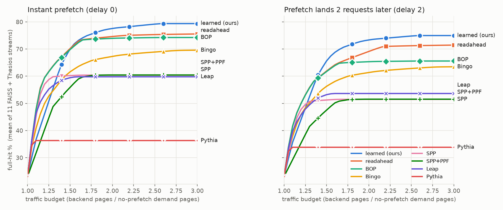
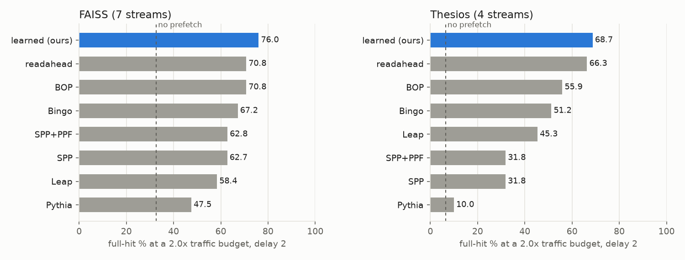
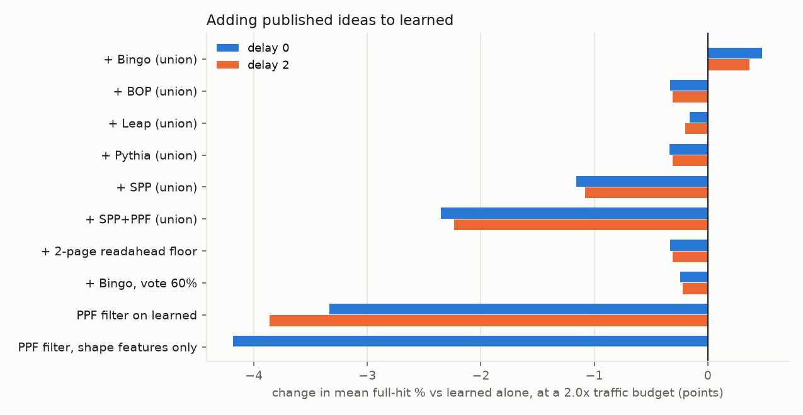

# Published prefetchers vs `learned` on VM disk streams

**Question.** `learned` (nextreq + neighborhood, `DECISIONS.md` 2026-11-07) borrows ideas from several well-known
prefetchers: SPP's confidence-product lookahead, SMS/Bingo's spatial footprints, and SARC/PACMan-style eviction. If we
port the newer published prefetchers to the disk setting, staying faithful to their designs, does any of them beat
`learned`? And can any of their ideas be added to `learned` to improve it?

**Short answer.** No published design beats `learned` once the budget allows about 1.5× traffic or more. None of the
ten ways we tried to graft their ideas onto `learned` improved it by more than the run-to-run noise. Below about 1.5×
traffic, plain readahead (and BOP, which ends up the same) is the better choice, because `learned` cannot run that
cheaply.



## Summary

* **Ranking at a 2× traffic budget**, mean full-hit % over 11 FAISS + Thesios VM streams:

  | | learned | readahead | BOP | Bingo | SPP | SPP+PPF | Leap | Pythia |
  |---|---|---|---|---|---|---|---|---|
  | instant prefetch (delay 0) | **77.6** | 74.6 | 73.9 | 67.3 | 60.4 | 60.4 | 59.8 | 36.3 |
  | prefetch lands 2 requests later (delay 2) | **73.4** | 69.1 | 65.3 | 61.4 | 51.5 | 51.5 | 53.6 | 33.8 |

  With a 64 MiB cache instead of 256 MiB the order is the same (learned 74.0, readahead 71.5, BOP 71.2, Bingo 65.6,
  SPP 57.8, SPP+PPF 57.9, Leap 55.5, Pythia 35.2).
* **The hardware prefetchers (SPP, PPF, Bingo, Pythia) don't fit this stream.** They were built for single cache-line
  accesses inside a 4 KiB physical page, with a PC to tell access sites apart. Here, each request is already a burst of
  1–16 pages shaped by the guest's readahead, there is no PC, streams cross every region boundary, and there are only
  20k–400k requests, too few for slow learners to converge. They predict accurately (often 70–90% of their prefetches
  get used) but not far enough ahead, so their hit rate stops rising at 1.1–1.6× traffic.
* **Leap** (remote memory) assumes one fault stream with a single majority stride. The guest interleaves several
  streams, and FAISS reads arrive out of order, so Leap's trend detector rarely finds a majority.
* **BOP converges to offset 1, which turns it into readahead.** At delay 0 its curve is identical to readahead's. Its
  timeliness mechanism (learning only from prefetches that have arrived) is implemented and works at its published
  degree of 1. Under delay 2 it lifts BOP from 9% to 39% full hit on Thesios, but that still leaves it at
  readahead's level.
* **None of the hybrids helped.** We tried unions with each published prefetcher, a readahead floor, stricter Bingo
  votes, and a PPF-style perceptron filter over `learned`. The best, `learned + Bingo`, gains +0.5 points at 2×
  (+1.1 to +1.4 on Thesios) and nothing at 3×, which is within run-to-run noise. The PPF-style filter *cost* 3–4
  points.
* **Where the published designs win:**
  1. *Below about 1.5× traffic.* `learned` can't run cheaper than about 1.4× even at `theta=99`, while 2–4 pages of
     readahead get FAISS to 62–68% at 1.1–1.3×.
  2. *On Thesios at delay 0,* readahead tuned to 16–32 pages beats `learned` by about 1 point at 2×. Once prefetches
     take time to arrive (delay 2), `learned` wins by 2.4 points.
  3. *On a synthetic repeating spatial pattern,* SPP gets 99.96% against `learned`'s 81%. The real streams don't
     contain that pattern.

## Setup

* **Harness:** `bin/psim` replays the captured VM streams (`logs/pf_streams/*`, described in `tools/pf/README.md`)
  through the real policy code. 64 KiB pages, 256 MiB cache (4096 pages), `lru_seg` eviction for every policy.
* **Streams:** FAISS on-disk IVF in 7 variants (guest RAM 512 MiB/1 GiB/2 GiB; guest readahead 0/32/512 KiB; nprobe
  16), Thesios in 4 variants (RAM 1/4 GiB; readahead 32/512 KiB), and YCSB as a random-access control.
* **Metrics:** *full hit* is the fraction of requests served entirely from cache. *Traffic* is backend pages fetched
  (demand plus prefetch) divided by the demand-miss pages of a no-prefetch run on the same stream. *Delay K* means a
  prefetched page only counts once K more requests have been served. Delay 2 is the closer stand-in for a real link.
* **Comparison at equal traffic:** each policy is swept over its own aggressiveness setting (readahead depth, `learned`
  theta, SPP's Tp, PPF's tau, Bingo's vote threshold, Leap's PW_max, BOP's degree). On each stream we take the best
  hit reachable within a traffic budget, interpolating linearly between that policy's points and anchoring at the
  no-prefetch point (1.0×). We then average across the 11 FAISS + Thesios streams. YCSB is reported separately (it is
  about 2% hit for everything).
* **Runs:** 948 grid runs at delay 0 plus 1008 at delay 2, then 1128 hybrid runs, 528 PPF-filter runs and 696
  small-cache runs. Each run is a single deterministic replay, so differences of about 1 point or less are noise.

## What was ported, and how faithfully

The ports are in `policies/policy_lit.cpp`. Every policy keeps its published tables, thresholds and update rules. The
same port rules apply to all of them:

* **One cache line becomes one cache page (64 KiB).** The original's 4 KiB physical page becomes a *region* of pages:
  64 pages for SPP and Pythia (the 64 lines in a 4 KiB page), 32 pages for Bingo (its 2 KiB region of 32 lines).
* **One request becomes several accesses.** The originals trigger on every L2 access, so an NBD request of n pages is
  fed as n accesses in ascending order. That is what an L2 sees for a multi-line burst.
* **There is no PC on a disk.** Features that need only the PC are dropped. "PC + X" features become X alone, or X
  plus the request-length bucket where noted.
* **Prefetches fill instantly,** as in psim and nbd_server. The delay-2 runs model latency outside the policy.

| policy | paper | kept as published | adapted |
|---|---|---|---|
| `bop` | Best-Offset, Michaud HPCA'16 | 52 offsets (2^i·3^j·5^k ≤ 256), 256-entry RR table, SCOREMAX 31, ROUNDMAX 100, BADSCORE 1, degree 1, triggers on a miss or a prefetched hit | `lat=K` delays RR insertion by K requests to stand in for fill latency. The `degree>1` sweep points are our extension; at degree 1 BOP stops at ≤1.06× traffic |
| `spp` | Signature Path, Kim et al. MICRO'16 | 256-entry ST, 12-bit signature `(sig<<3)^δ`, 512-entry PT with 4 deltas and 4-bit counters, 8-entry GHR, global accuracy α, P_d = α·C_d·P_{d-1}, Tp = 25% | no L2/LLC split, so no fill threshold. `cross=1` lets lookahead run past the region boundary (a disk has no page boundary); both settings are reported |
| `ppf` | Perceptron Prefetch Filtering, Bhatia et al. ISCA'19 | SPP made aggressive (Tp 5%); 5-bit weights −16..15; 1024-entry direct-mapped prefetch and reject tables; trains up on a demand hit of a prefetched or rejected page, down on eviction of an unused prefetch | 8 of the paper's features (its 3 PC features removed; PC⊕Depth → Depth, PC⊕Delta → Delta). θp = 90 and θn = −80 come from the authors' public code as I recall it; the paper doesn't print them. Accept threshold τ is swept |
| `bingo` | Bingo, Bakhshalipour et al. HPCA'19 | 2 KiB-equivalent region (32 pages), 128-entry accumulation table, 16K-entry 16-way PHT indexed by short event and tagged by long event, long match first, else ≥20% vote; a generation ends when a page is evicted or the region leaves the accumulation table | long event = PC+address and short = PC+offset become (length bucket, address) and (length bucket, offset); `pc=0` uses no PC stand-in at all, which gives the same result |
| `pythia` | Pythia, Bera et al. MICRO'21 (Table 2) | features "PC+Delta" and last-4 deltas; actions {−6,−3,−1,0,1,3,4,5,10,11,12,16,22,23,30,32}; R_AT 20, R_AL 12, R_CL −12, R_IN^H −14 / R_IN^L −8, R_NP^H −2 / R_NP^L −4; α 0.0065, γ 0.556, ε 0.002; 2 vaults × 3 planes × 128 × 16 QVStore, Q = max over vaults, initialised to 1/(1−γ); 256-entry EQ with SARSA update on eviction | PC → length bucket. There's no bandwidth signal, so `bw=0/1` picks the low- or high-bandwidth rewards. A 10× α was also tried; every variant gives the same result |
| `leap` | Leap, Al Maruf & Chowdhury ATC'20 (Alg. 1–2) | H = 32 delta history, Boyer-Moore majority over windows 4, 8, 16, 32 (needs ⌊w/2⌋+1 votes); PW from prefetched hits (next power of 2 above C_hit+1), 1 if a trend exists but no hits, 0 to suspend, never below half the previous window, PW_max 8; prefetches along the trend, or the last trend if none; acts only on faults | every page of a request is logged as an access; any missing page makes it a fault. PW_max is swept up to 128 |

**Sanity checks on synthetic streams** (full-hit %, 20k requests each; the generator is described under *Reproduce*):

| stream | readahead:8 | learned | BOP | SPP | PPF | Bingo | Pythia | Leap |
|---|---|---|---|---|---|---|---|---|
| sequential, 1-page requests | 100 | 100 | 100 | 99.97 | 99.97 | 76.9 | 93.1 | 88.9 |
| sequential, 2-page requests | 100 | 100 | 0 | 99.98 | 99.98 | 84.1 | 0.2 | 80.0 |
| stride 3 | 100 | 99.97 | 92.2 | 99.97 | 99.97 | 84.3 | 88.9 | 88.9 |
| repeating spatial pattern in 32-page regions | 83.3 | 80.8 | 93.4 | **99.96** | **99.96** | 80.6 | 53.4 | 0 |
| 4 interleaved sequential streams | 99.98 | 99.98 | 99.92 | 99.90 | 99.90 | 76.9 | 92.6 | 50.0 |
| uniform random | 0.4 | 0.4 | 0.4 | 0.4 | 0.4 | 0.4 | 0.4 | 0.4 |

Each low number has a known cause in the design, not a bug:

* **BOP and Pythia** prefetch one page per access. With 2-page requests, each request then has one page hit and one
  missed (0% full hit, 50% page hit).
* **Bingo** learns nothing until its accumulation table first evicts a region, after 128 regions. In the synthetic
  streams that is 20–25% of the run.
* **Leap** only prefetches on a fault, so it misses once per window. It finds no majority delta in a spatial pattern,
  and none across interleaved streams.

## Results

### At a fixed traffic budget

| policy | d0 @1.25× | d0 @1.5× | d0 @2× | d0 @3× | d2 @1.5× | d2 @2× | d2 @3× |
|---|---|---|---|---|---|---|---|
| learned (ours) | 50.8 | 70.0 | **77.6** | **79.4** | **65.6** | **73.4** | **75.0** |
| readahead | **61.7** | **70.2** | 74.6 | 75.6 | 61.9 | 69.1 | 71.5 |
| BOP | 61.6 | 69.8 | 73.9 | 74.3 | 61.7 | 65.3 | 65.6 |
| Bingo | 52.7 | 61.6 | 67.3 | 69.6 | 56.3 | 61.4 | 63.5 |
| SPP (`cross=1`) | 58.8 | 60.2 | 60.4 | 60.4 | 51.2 | 51.5 | 51.5 |
| SPP+PPF | 44.6 | 55.9 | 60.4 | 60.4 | 47.5 | 51.5 | 51.5 |
| Leap | 55.3 | 59.4 | 59.8 | 59.8 | 53.2 | 53.6 | 53.6 |
| Pythia | 36.3 | 36.3 | 36.3 | 36.3 | 33.8 | 33.8 | 33.8 |

A value that stays the same across budgets means the policy can't spend more traffic even at its most aggressive
setting. That holds for SPP, PPF, Leap and Pythia.

### By workload, at 2× traffic and delay 2



| policy | FAISS d0 | FAISS d2 | Thesios d0 | Thesios d2 |
|---|---|---|---|---|
| learned (ours) | **79.6** | **76.0** | 74.1 | **68.7** |
| readahead | 74.2 | 70.8 | **75.3** | 66.3 |
| BOP | 74.2 | 70.8 | 73.5 | 55.9 |
| Bingo | 70.3 | 67.2 | 62.1 | 51.2 |
| SPP | 67.9 | 62.7 | 47.3 | 31.8 |
| SPP+PPF | 67.9 | 62.8 | 47.3 | 31.8 |
| Leap | 62.4 | 58.4 | 55.2 | 45.3 |
| Pythia | 50.3 | 47.5 | 11.8 | 10.0 |

### Random-access control (YCSB) and policy cost

| policy | default spec | YCSB traffic | cost per request (Thesios / FAISS) |
|---|---|---|---|
| learned | `learned:theta=40` | 1.00× | 4.2 / 2.9 µs |
| readahead | `readahead:pages=8` | 8.74× | 0.03 / 0.03 µs |
| BOP | `bop` | 1.56× | 0.28 / 0.16 µs |
| Bingo | `bingo` | 1.00× | 0.45 / 0.25 µs |
| SPP | `spp:cross=1` | 1.07× | 0.95 / 0.45 µs |
| SPP+PPF | `ppf:cross=1` | 1.25× | 1.6 / 0.7 µs |
| Leap | `leap` | 1.00× | 0.31 / 0.18 µs |
| Pythia | `pythia` | 1.10× | 3.4 / 1.6 µs |

Every published design except BOP stays close to 1× on random traffic, as `learned` does. BOP keeps prefetching on
random misses, most likely because chance matches across 52 offsets × 100 rounds clear its low BADSCORE of 1 (not
instrumented). Costs were measured once with `psim` on this machine, and all are far below the 1 ms emulated link RTT.

## Why each design falls short here

* **SPP** has no history at the start of each new region (signature 0) unless a lookahead was carried over through
  its small GHR. It also
  multiplies its lookahead confidence by global accuracy α at every step, so the lookahead dies after 2–3 steps. Even
  at Tp = 5% it never spends more than about 1.3–1.6×. That suits an L2, where one line ahead is enough. A Thesios
  request is 16 pages and needs the whole next request fetched ahead. Letting lookahead cross regions (`cross=1`)
  helps by less than 1 point.
* **PPF** can only remove candidates SPP proposes, so its ceiling is SPP's. Its value in the paper is letting SPP run
  more aggressively at the same accuracy. Here, SPP's limit is how far ahead it reaches, not how accurate it is.
* **Bingo** learns a footprint only when a region's generation ends, which happens on eviction. With a 256 MiB cache
  that is long after the pattern was useful. Thesios regions rarely repeat, so it mostly falls back to short-event
  votes, which are coarse. It is the strongest of the hardware designs on FAISS, where lists are revisited, at
  67–70%.
* **Pythia** issues exactly one prefetch per page access, within ±32 pages. Its learning rate (α = 0.0065) was tuned for
  billions of accesses, and 10× it changes nothing, because the limit is the single prefetch per access, not the
  learning speed. It settles on small positive offsets, which mostly land inside the request that is already being
  read.
* **Leap** detects one majority stride across the whole interleaved stream and grows its window only after prefetch
  hits. FAISS reads arrive out of order (the guest's mmap read-around), and Thesios interleaves streams about 100
  requests apart, so it often finds no trend and stops prefetching. Raising PW_max helps Thesios (45% at 16 → 56% at
  128) but levels off by about 1.5× traffic, below readahead.
* **BOP** finds that offset 1 scores best, because everything here is short sequential runs, so it behaves like
  readahead. At delay 2 on Thesios, our degree sweep stops at 16 pages, one request ahead, which isn't enough to
  cover 2 requests of latency. Readahead's sweep goes to 64 pages.

`learned` avoids all of these by predicting at the level of whole requests. It tracks each interleaved stream
separately, predicts the byte-exact length and gap of the next request, and learns which nearby pages fill in around
out-of-order windows. That is the extra information the line-based designs lack.

## Trying to improve `learned` with these ideas



| variant (all at a 2× budget, change in points vs learned) | d0 all | d0 FAISS | d0 Thesios | d2 all | d2 FAISS | d2 Thesios |
|---|---|---|---|---|---|---|
| learned + Bingo (union) | +0.5 | −0.0 | +1.4 | +0.4 | −0.0 | +1.1 |
| learned + BOP (union) | −0.3 | −0.5 | −0.1 | −0.3 | −0.4 | −0.1 |
| learned + Leap (union) | −0.2 | −0.2 | −0.0 | −0.2 | −0.3 | −0.0 |
| learned + Pythia (union) | −0.3 | −0.5 | −0.1 | −0.3 | −0.4 | −0.1 |
| learned + SPP (union) | −1.2 | −1.7 | −0.2 | −1.1 | −1.5 | −0.3 |
| learned + SPP+PPF (union) | −2.4 | −3.7 | −0.0 | −2.2 | −3.4 | −0.2 |
| learned + 2-page readahead floor | −0.3 | −0.5 | −0.1 | −0.3 | −0.4 | −0.1 |
| learned + Bingo, 60% vote | −0.2 | −0.3 | −0.1 | −0.2 | −0.3 | −0.1 |
| PPF-style perceptron filter on aggressive learned | −3.3 | −2.2 | −5.3 | −3.9 | −2.3 | −6.6 |
| same filter, without the address features | −4.2 | −2.6 | −7.0 | – | – | – |

* **Unions.** A union only helps if the added prefetcher finds pages `learned` misses at a lower cost than
  `learned`'s own threshold would. Only Bingo does, a little, on Thesios, and at a 3× budget even that gain is gone
  (79.2 vs 79.4). SPP and PPF unions spend traffic on pages `learned` would have fetched anyway.
* **PPF-style filter (our hybrid, `learnedppf`).** This is PPF's own recipe: run the base aggressively (theta 10–40)
  and let an online perceptron decide each candidate. The features are which part proposed the page, signed distance,
  request length, whether the request is contiguous with the last one, and trigger/candidate address and region. With
  the filter turned off, the wrapper reproduces `learned` to within 0.1 point, so the loss comes from the filter
  itself. It isn't overfitting on addresses either: dropping the address features is slightly worse still. The
  perceptron is learning what `learned`'s count tables already know, from a noisier signal ("evicted without being
  used" vs "demanded"), so it removes good prefetches along with the futile ones. A filter needs a signal the base
  predictor doesn't already have. On this stream, every host-side signal is already in `learned`.

## Conclusions

1. **With host-only signals, `learned` is still the best prefetcher we have measured once traffic is above about
   1.5×.** At 2× it leads readahead and BOP by 3–4 points at delay 0 and by 4–8 points at delay 2. It is 10–41 points
   ahead of the hardware designs (Bingo, SPP, PPF, Pythia) and Leap.
2. **The published designs don't add information `learned` lacks.** This matches the earlier finding that the
   remaining headroom is in signals the host can't see, such as the first access of each list or stream
   (`SIGNAL_HEADROOM.md`), not in better modelling of the host stream.
3. **One practical gap is worth fixing:** `learned` has a traffic floor of about 1.4× (at `theta=99` its nextreq part
   still runs at a 24% threshold). For deployments with tight budgets, readahead of 2–4 pages is better below 1.5×. A
   `learned` setting that also scales nextreq's threshold, or falls back to small readahead, would cover that range.
   We haven't tried this yet.

## Caveats

* Each number comes from a single deterministic replay per stream, so differences of 1 point or less are noise.
* Delay is modelled in psim, outside the policies. Pythia's "accurate but late" reward and SPP's fill level never come
  into play. BOP's timeliness is only modelled through `lat`.
* "Faithful" means the published algorithms and parameters applied to the port rules above. The PC stand-ins and the
  line→page and page→region mapping are our choices. A different region size might help SPP and Pythia somewhat, but
  wouldn't fix the one-prefetch-per-access and lookahead limits that dominate here.
* PPF's θp/θn come from the authors' code as recalled, not from the paper. Since PPF's ceiling is SPP's, they don't
  change the conclusion.
* No live-VM runs. psim matched nbd_server to 0.01% and a live VM to about 0.5% for `learned` (`tools/pf/README.md`).

## Reproduce

```bash
tools/pf/build.sh                                         # bin/psim (links policies/*.cpp incl. policy_lit.cpp)
python3 tools/pf/lit_eval.py --name grid_d0               # all families, delay 0     -> logs/pf_lit/grid_d0.csv
python3 tools/pf/lit_eval.py --name grid_d2 --delay 2
F=learned,learned_hi,readahead,learned+ra2,learned+ra4,learned+bingo,learned+bingo60,learned+bingo100,bingo
python3 tools/pf/lit_eval.py --name hyb_d0 --families $F; python3 tools/pf/lit_eval.py --name hyb_d2 --delay 2 --families $F
python3 tools/pf/lit_eval.py --name ppfw_d0 --families learned,learned_hi,learnedppf          # and --delay 2 -> ppfw_d2
python3 tools/pf/lit_eval.py --name ppfs_d0 --families learnedppf_shape
python3 tools/pf/lit_eval.py --name cap1024_d0 --extra '--cap 1024' --families readahead,learned,learned_hi,bop,spp_x,ppf,bingo,pythia,leap,learned+bingo
python3 tools/pf/lit_report.py                            # figures -> capture_results/lit/, tables on stdout
```

Single policies: `bin/psim --trace logs/pf_streams/th_m1g/features.csv --max-offset 8796076441600 --policy spp:cross=1
--evict lru_seg [--delay 2]`. Spec names: `bop[:degree,lat]`, `spp[:tp,cross,depth]`, `ppf[:tp,tau,cross]`,
`bingo[:vote,pc]`, `pythia[:bw,alpha]`, `leap[:pwmax,w0,h]`, `learnedppf[:theta,tau,addr]`.

The synthetic sanity streams are 20k requests of 64 KiB pages: sequential 1- and 2-page, stride 3, the pattern
{0,2,5,9,17,30} repeated in consecutive 32-page regions, 4 sequential streams interleaved 1M pages apart, and uniform
random.

## References

* P. Michaud, "Best-Offset Hardware Prefetching," HPCA 2016.
* J. Kim et al., "Path Confidence based Lookahead Prefetching" (SPP), MICRO 2016.
* E. Bhatia et al., "Perceptron-Based Prefetch Filtering," ISCA 2019. <https://par.nsf.gov/servlets/purl/10121116>
* M. Bakhshalipour et al., "Bingo Spatial Data Prefetcher," HPCA 2019.
* R. Bera et al., "Pythia: A Customizable Hardware Prefetching Framework Using Online Reinforcement Learning,"
  MICRO 2021. <https://arxiv.org/abs/2109.12021>
* H. Al Maruf and M. Chowdhury, "Effectively Prefetching Remote Memory with Leap," USENIX ATC 2020.
  <https://www.usenix.org/conference/atc20/presentation/al-maruf>
